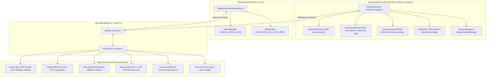

<p align="center">
  
</p>

<h1 align="center">HyperStream for Android</h1>

<p align="center">
  <strong>128-Thread Native Rust Download Accelerator & BitTorrent Engine for Android</strong>
</p>

<p align="center">
  <a href="https://github.com/djsusmith/hyperstream-android/actions/workflows/android-ci.yml"></a>
  <a href="https://github.com/djsusmith/hyperstream-android/releases/latest"></a>
  <a href="https://github.com/djsusmith/hyperstream-android/blob/main/LICENSE"></a>
  <a href="https://djsusmith.github.io/hyperstream-android/"></a>
  
  
</p>

<p align="center">
  <a href="#-quick-download"><strong>⬇️ Download APK (v0.6.1)</strong></a> •
  <a href="https://djsusmith.github.io/hyperstream-android/"><strong>🌐 Official Website</strong></a> •
  <a href="#-key-features"><strong>✨ Features</strong></a> •
  <a href="#-comparison"><strong>📊 Comparison</strong></a> •
  <a href="#-architecture"><strong>🏗️ Architecture</strong></a> •
  <a href="#-building-from-source"><strong>🛠️ Build Guide</strong></a>
</p>

---

## 🚀 Overview

**HyperStream** (`com.hyperstream.downloadmanager`) is the native Android port and mobile evolution of [Mister Download Manager (`anefzaoui/misterdownloadmanager`)](https://github.com/anefzaoui/misterdownloadmanager). It embeds the full, battle-tested upstream Rust multi-connection engine (`libmdm_android.so`) directly into a modern **Jetpack Compose Material 3** interface styled with an **Obsidian OLED Dark** flagship design language.

Engineered specifically for 64-bit Android devices, HyperStream bypasses traditional JVM socket bottlenecks, unlocking **up to 128 parallel segmented connections** per file, full BitTorrent swarm streaming, automated link interception, YouTube 4K/8K media extraction, watermark-free TikTok downloads, and Real-Debrid cloud integration—**with 0 ads, 0 trackers, and 0 subscription paywalls**.

---

## ⚡ Quick Download

Get the official, production-signed release APK directly from GitHub:

<p align="center">
  <a href="https://github.com/djsusmith/hyperstream-android/releases/download/v0.6.1/HyperStream-v0.6.1-arm64.apk">
    
  </a>
</p>

| Metric | Specification |
| :--- | :--- |
| **Package Name** | `com.hyperstream.downloadmanager` |
| **Latest Version** | **v0.6.1** (Build 61) |
| **Target Architecture** | `arm64-v8a` (Native Rust + JNI) |
| **Minimum OS** | Android 9.0 (API 28) or higher |
| **Release Signing** | 4096-bit RSA (V1, V2, V3, and V4 APK Signing) |
| **Checksum / Cleanliness** | 100% Open Source (GPLv3), 0 Adware, 0 Loggers |

> [!TIP]
> **First-time Install Note (Google Play Protect):**
> Because HyperStream is a community open-source release distributed directly via GitHub rather than the Google Play Store, Play Protect may prompt *"Play Protect hasn't seen this app before"*.
> Simply tap **"More details"** ➔ **"Install anyway"** (or *"Install without scanning"*). The code is 100% open, transparent, and auditable right here on GitHub.

---

## ✨ Key Features

### ⚡ 1. 128-Thread Segmented Accelerator (`mdm-engine`)
- **Parallel Chunking:** Unlocked `1..=128` simultaneous connections per transfer (`MAX_CONNECTIONS_UNLOCKED = 128`).
- **Dynamic Work-Stealing:** Automatic segment halving down to `12 KB` (`min_split`), transferring pending byte ranges from slow or stalled connections to fast ones.
- **Crash-Safe Atomic Resuming:** Uses atomic chunk writing (`.mdm.part` craft-atomic files) so unexpected battery loss or system reboots never corrupt your downloads.
- **Whole-File Checksum Verification:** Real-time hardware-accelerated integrity verification supporting `CRC32`, `MD5`, `SHA-1`, `SHA-256`, and `SHA-512`.
- **Built-in Cloud Resolvers:** Automatic confirmation bypass for Google Drive virus-scan limits and MediaFire intermediate landing pages.
- **Advanced Network Stack:** Native HTTP, HTTPS, SOCKS5 proxies, PAC script execution via embedded `rquickjs`, DNS-over-HTTPS / DNS-over-TLS (`DoH`/`DoT` via `hickory-resolver`), and dedicated VPN interface locking with kill switch.

### 🧲 2. Native BitTorrent & RSS Swarm Client (`mdm-torrent` / `librqbit`)
- **Full Swarm Protocol:** Native support for Magnet links, `.torrent` files, DHT (Distributed Hash Table), PEX (Peer Exchange), LSD (Local Peer Discovery), and UPnP/NAT-PMP port mapping.
- **Sequential Streaming:** Download media pieces sequentially from start to finish, allowing you to preview and play videos while the transfer is still ongoing.
- **Granular Swarm Control:** Per-file selective downloading, real-time peer country flags, tracker statuses, and piece-bitmap visualization.
- **Automated RSS Grabber:** Regex-based feed filters to automatically catch and download newly published releases from your favorite trackers.

### 🎬 3. Universal Smart Link Catcher & Media Sniffer
- **One-Tap Share Sheet & System Interception:** Seamlessly intercepts links from Chrome, Brave, Kiwi, YouTube, TikTok, Facebook, and Instagram via Android `ACTION_VIEW` and `ACTION_SEND`.
- **Integrated Video Sniffer (`VideoGrabberWebView`):** In-app headless browser sniffs `<video>`, HLS `.m3u8` playlists, DASH `.mpd` manifests, `.mp4`, and `.webm` streams directly from web pages.
- **Smart Format & Quality Sheet:** Automatically extracts 4K/1080p video resolutions, watermark-free TikTok videos, and high-bitrate 320 kbps MP3 audio conversions.
- **JDownloader Click'n'Load 2 (CNL2):** Local loopback server (`127.0.0.1:9666`) catches protected batch links directly from one-click filehosters.

### 📂 4. Android Native File Experience
- **Instant 1-Tap Open:** Launch completed downloads straight from the download card or the Inspector Sheet using AndroidX `FileProvider` with zero `FileUriExposedException` errors.
- **Package Installer Integration:** Directly triggers Android's native APK Package Installer for downloaded applications and updates.
- **Safe Permanent Deletion Dialog:** Tapping the delete button prompts an explicit confirmation dialog with an *"Also permanently delete file from storage"* safeguard—preventing accidental data loss and thoroughly purging leftover `.mdm.part` files.

### 🎨 5. Obsidian OLED Flagship Design
- **Tailored for High-Refresh OLED Displays:** Crafted with deep Obsidian black (`#07080C`), elevated card darks (`#0E1017`), Radiant Indigo (`#818CF8`), and Sky Blue (`#38BDF8`) accents.
- **128-Connection Waterfall Visualizer:** Live segment progress bar renders all active worker connections, byte ranges, individual transfer rates, and connection states.

### 🔋 6. Non-Stop Background Service & Shizuku Power
- **Partial WakeLock & High-Perf Wi-Fi Lock:** `HyperStreamDownloadService` holds a foreground service with `PowerManager.PARTIAL_WAKE_LOCK` and `WifiManager.WIFI_MODE_FULL_HIGH_PERF`, ensuring multi-gigabyte transfers finish uninterrupted even when your phone's screen is locked.
- **Optional Shizuku (`rish`) Integration:** Grants elevated `uid=2000` ADB privileges for 1-tap Android Doze battery whitelisting, silent background app updates (`pm install -r`), and direct `/Android/data` access without root.

---

## 📊 Comparison Matrix

| Feature | HyperStream (v0.6.1) | 1DM+ / IDM Android | ADM (Advanced DM) | Stock Browsers |
| :--- | :---: | :---: | :---: | :---: |
| **Core Engine** | **Native Rust (ARM64)** | Java / C++ | Java | Chromium / WebKit |
| **Max Connections** | **128 Threads (Dynamic)** | 32 Threads | 16 Threads | 1–4 Threads |
| **BitTorrent Swarm** | **Yes (Full DHT / PEX)** | Only in paid/plus | Only in specific variants | ❌ No |
| **Ads & Spyware** | **0% (None, Ever)** | Heavy Banner / Ads | Heavy Banner / Ads | Tracking Telemetry |
| **License** | **GPL-3.0 Open Source** | Closed Source | Closed Source | Proprietary |
| **Video Sniffer & No-WM** | **Built-in (4K / TikTok / HLS)**| Web Browser only | Browser only | ❌ No |
| **Real-Debrid / Multi-Debrid**| **Native Integration** | ❌ Manual | ❌ Manual | ❌ No |
| **Shizuku / ADB Privileges**| **Yes (Silent Update / Doze)**| ❌ No | ❌ No | ❌ No |
| **Open File / Safe Delete** | **Integrated FileProvider**| Mixed | Basic | Basic |

---

## 🏗️ Architecture



---

## 🛠️ Building from Source

HyperStream can be built either on a Linux workstation or directly on-device in Android Termux / Antigravity userspace.

### Prerequisites
1. **Rust Toolchain:** `rustc 1.82+` with `aarch64-linux-android` target installed (`rustup target add aarch64-linux-android`).
2. **Android NDK:** NDK `r26c` or `r27+` (`ANDROID_NDK_HOME` exported).
3. **Java Development Kit:** OpenJDK 17 or OpenJDK 21.
4. **Android SDK:** Build-Tools `35.0.0`, Platforms `android-35`.

### 1. Clone Repository & Submodules
```bash
git clone https://github.com/djsusmith/hyperstream-android.git
cd hyperstream-android
```

### 2. Compile the Rust JNI Bridge
```bash
cd upstream/crates/android-ffi
cargo build --release --target aarch64-linux-android
cd ../../..

# Copy the compiled native library into the Android project
mkdir -p android/app/src/main/jniLibs/arm64-v8a
cp upstream/target/aarch64-linux-android/release/libmdm_android.so \
   android/app/src/main/jniLibs/arm64-v8a/
```

### 3. Run Unit Tests & Build Release APK
```bash
# Using the bundled helper script (handles on-device JDK & aapt2 paths)
bash scripts/run-gradle.sh :app:testReleaseUnitTest
bash scripts/run-gradle.sh :app:assembleRelease
```

The compiled and production-signed APK will be generated at:
```
android/app/build/outputs/apk/release/app-release.apk
```

---

## 🔄 Dual Release Channels & Upstream Sync

HyperStream stays 100% faithful to [Mister Download Manager](https://github.com/anefzaoui/misterdownloadmanager) through automated CI synchronization:

- **Stable Channel (`stable`):** Tracks verified, tagged upstream releases (`v0.5.2`, `v0.6.0`, `v0.6.1`). Recommended for daily high-stability downloading.
- **Nightly / Bug-Fix Channel (`nightly`):** Automated GitHub Actions (`.github/workflows/upstream-sync.yml`) monitors upstream commits every 6 hours and compiles fresh builds whenever bug fixes land.

You can switch between update channels at any time inside **Settings ➔ Update Channel**.

---

## 📋 Changelog

### v0.6.1 — 2026-11-18
- 🔄 **1DM-style Link Refresh** — tap Refresh Link on any Failed/Paused download to supply a fresh URL and seamlessly resume from existing byte ranges; no re-downloading of completed chunks
- ✅ **Seamless resume from disk state** — `.mdm.part` and `.mdm.json` are detected on restart and the download continues from where it left off
- 🔁 **AddDownload deduplication** — re-adding a stalled download refreshes the URL in-place instead of creating duplicates
- 🛠️ **Upstream sync CI fix** — force-stage `libmdm_android.so`, guard empty commits, rebase before push

### v0.6.0
- Initial public stable release
- 128-thread segmented Rust engine, BitTorrent swarm, YouTube 4K/TikTok no-WM, Obsidian OLED design

---

## 🤝 Contributing

Contributions, feature suggestions, and bug reports are warmly welcome!
1. Fork the repository.
2. Create your feature branch (`git checkout -b feat/amazing-speedup`).
3. Commit your changes (`git commit -m 'feat: add ultra-fast piece selector'`).
4. Push to the branch (`git push origin feat/amazing-speedup`).
5. Open a Pull Request.

---

## 📜 License & Credits

- **License:** Distributed under the **GNU General Public License v3.0 or later** ([GPL-3.0-or-later](LICENSE)).
- **Creator & Maintainer:** **Ahnaf Hasan Susmith** ([@djsusmith](https://github.com/djsusmith)) • [`susdj.96@gmail.com`](mailto:susdj.96@gmail.com)
- **Built with:** Developed using Google Antigravity on native ARM64 Android (Snapdragon 8 Elite).
- **Core Engine Attribution:** Built upon the architecture of [Mister Download Manager](https://github.com/anefzaoui/misterdownloadmanager) by Ahmed Nefzaoui.
