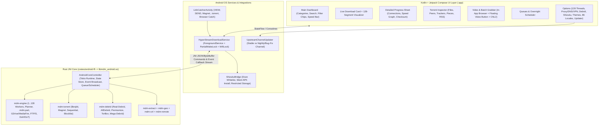

# HyperStream Download Manager for Android — Design Specification

- **Date:** 2026-11-15
- **Project Name:** **HyperStream** (`HyperStream Download Manager`) — *Your call: selected as a clean, fast-sounding Android brand while preserving GPL-3.0 attribution to upstream `anefzaoui/misterdownloadmanager`.*
- **Application ID:** `com.hyperstream.downloadmanager`
- **Target GitHub Repository:** `https://github.com/djsusmith/hyperstream-android` *(Your call: under your authenticated GitHub account `djsusmith`)*
- **License:** GPL-3.0-or-later (matching upstream `anefzaoui/misterdownloadmanager`)

---

## 1. Intent & Why

Port **Mister Download Manager (MDM)** (`anefzaoui/misterdownloadmanager`) to Android with **1-to-1 feature parity** so the user gets desktop MDM's benchmark-winning Rust segmented download engine, BitTorrent client, video/gallery grabber, Debrid integration, queues, scheduler, and remote control natively on their Galaxy S25 Ultra (`SM-S938B`, Snapdragon 8 Elite `aarch64`).

On Android, the app must feel like a first-class mobile citizen with:
- A modern, high-density **Jetpack Compose Material 3 UI** (verified and iterated via `/compose-preview`).
- **Automatic download link interception** (Android Browser/Share intents, clipboard monitor, built-in browser with floating "Download Video" button, and local extension bridge for Kiwi/Firefox).
- **Maximum threads unlocked** (`1..=128` simultaneous connections per download).
- **Reliable background execution** (`ForegroundService` holding `PARTIAL_WAKE_LOCK` and `WIFI_MODE_FULL_HIGH_PERF` while active).
- **Optional Shizuku integration** for elevated Android operations (Doze whitelist, silent/1-tap APK install, restricted `/Android/data` access, and native helper execution).
- **Automatic Upstream Sync & Dual Update Channels (`Stable` & `Bug-Fix / Nightly`)** so every upstream `anefzaoui/misterdownloadmanager` update or bug fix automatically flows into our repo and into the phone app's built-in updater.

---

## 2. Goals, Non-Goals, and Anti-Goals

### Goals
1. **1-to-1 Upstream Engine Parity:** Use upstream's actual Rust crates (`mdm-engine`, `mdm-torrent`, `mdm-debrid`, `mdm-extract`, `mdm-geo`, `mdm-cnl`, `mdm-ipc`, `mdm-remote`) compiled for `aarch64-linux-android` via JNI (`libmdm_android.so`).
2. **128-Thread Segmented Engine:** Expose the full `1..=128` connection slider (`MAX_CONNECTIONS_UNLOCKED = 128`) in the UI and engine options, with live visual segment bars showing each worker's byte range.
3. **Complete Protocol & Feature Coverage:**
   - HTTP/1.1 & HTTPS segmented downloads with dynamic in-half splitting, slow-worker shedding, crash-safe `.mdm.part` resume state, and ETag/Last-Modified validation.
   - Built-in site resolvers (Google Drive confirmation/expired-link refresh, MediaFire direct link extraction).
   - FTP & FTPS segmented downloads (`suppaftp`).
   - BitTorrent & Magnet links (`librqbit` via `mdm-torrent`) with file selection, sequential piece mode, Peers/Trackers/Pieces/Files tabs, seeding ratio/time limits, IP blocklists, and RSS feeds with regex auto-download rules.
   - Video & Audio Stream Grabber (`yt-dlp` + `ffmpeg` integration for 1000+ sites, playlist selection, subtitles, audio-only extraction) and Image Galleries (`gallery-dl`).
   - Batch Download / Link Grabber + Click'n'Load 2 listener (`127.0.0.1:9666`).
   - Debrid account integration (`mdm-debrid`: Real-Debrid, AllDebrid, Premiumize, TorBox, Mega-Debrid).
   - Archive extraction (`mdm-extract`: `zip`, `tar`, `gz`, `xz` in-process; `7z` and `rar` via helper binary).
   - Categories (Music, Video, Programs, Documents, Compressed, Torrents, Custom), Queues (Main Queue, Secondary Queue, custom queues), Overnight Scheduler (start/stop times, days of week, max concurrent files, stop on completion), Per-Download & Global Speed Limiter, Checksum Verifier (`MD5`, `SHA-1`, `SHA-256`, `CRC32`), Custom DNS (Plain, DoT, DoH), Proxy/SOCKS5/PAC, VPN/Network Interface binding + Kill Switch, Geo-IP Server Country Flag (`mdm-geo`), and 86-language catalog support (`craft-i18n` TSV catalogs + RTL layout support).
4. **Android OS & Browser Integration:**
   - `IntentFilter` for `ACTION_VIEW` and `ACTION_SEND` (`http`, `https`, `ftp`, `ftps`, `magnet`, `content://` / `file://` `.torrent` files, and common downloadable MIME/extension patterns).
   - Background Clipboard Monitor (optional toggle) + Quick Settings Tile ("Add Download").
   - Built-in WebView Video & Link Browser with injected media-sniffer & floating **"Download Video with HyperStream"** overlay button (matching desktop MDM's video overlay button).
   - Local Extension Bridge (`127.0.0.1` HTTP/WebSocket + `mdm-remote` API) so mobile browsers with extension support (e.g., Kiwi Browser, Firefox Nightly) can forward captured downloads and cookies straight into HyperStream.
5. **WakeLock & Foreground Service:**
   - `HyperStreamDownloadService` (`ForegroundService` with `foregroundServiceType="dataSync|specialUse"`) acquiring `PowerManager.PARTIAL_WAKE_LOCK` and `WifiManager.WifiLock(WIFI_MODE_FULL_HIGH_PERF)` whenever at least one download, torrent, or scheduled queue is active, releasing immediately when idle.
6. **Optional Shizuku Integration:**
   - Dedicated Shizuku manager (`rikka.shizuku` / `rish` fallback) with Settings toggle:
     - One-tap Doze exemption (`dumpsys deviceidle whitelist +com.hyperstream.downloadmanager`).
     - Silent / 1-tap APK installation (`pm install -r <path>`) when a downloaded `.apk` finishes.
     - Direct file move/write into restricted `/storage/emulated/0/Android/data/` or `/Android/obb/` directories.
     - Executing standalone ARM64 helper binaries (`yt-dlp`, `ffmpeg`, `7z`) in `/data/local/tmp/hyperstream-bin` if needed.
7. **Upstream Sync & Bug-Fix Channel:**
   - Automated GitHub Actions workflow (`upstream-sync.yml`) polling `anefzaoui/misterdownloadmanager` and building/publishing rolling `nightly` (Bug-Fix) and `stable` APKs.
   - In-app updater with channel selector (`Stable` vs `Bug-Fix / Nightly`), upstream commit changelog viewer, and 1-tap download + install.

### Non-Goals
- Desktop windowing (`eframe` / `winit` / Win32 / X11 / Wayland) is not compiled on Android; `mdm-app`'s desktop GUI is replaced by native Jetpack Compose screens while reusing the Rust engine and state models.
- Targeting legacy 32-bit Android (`armeabi-v7a` / `x86`) in v1; primary target is 64-bit ARM (`arm64-v8a` / `aarch64-linux-android`, optimized for Snapdragon 8 Elite).

### Anti-Goals
- **Never** disturb, throttle to starvation, or kill the existing `ec2-kiwi-builder` GitHub Actions runner process on the user's EC2 instance. Any EC2 command or build job must run under `nice -n 19 ionice -c 3` in a separate `/home/ubuntu/hyperstream-build` directory with bounded concurrency (`-j4` while `ec2-kiwi-builder` is busy).
- **Never** ship mock or stubbed download logic in place of the real Rust `mdm-engine` / `mdm-torrent` crates.

---

## 3. Constraints

1. **EC2 Coexistence Constraint:** The user's EC2 machine is currently running `ec2-kiwi-builder` (building Chromium). If we SSH into EC2 using `/storage/emulated/0/Download/Antigravity.pem`, we must verify `pgrep -fa Runner.Listener` / `ninja` first, never touch `/opt/chromium` or `/home/ubuntu/actions-runner`, and run our Rust/Gradle tasks with `nice -n 19` or use local + GitHub Actions runners so the Chromium build is 100% unaffected.
2. **Android 17 (API 37) / Galaxy S25 Ultra Compatibility:** Must declare proper Android 14+ foreground service permissions (`FOREGROUND_SERVICE`, `FOREGROUND_SERVICE_DATA_SYNC`, `FOREGROUND_SERVICE_SPECIAL_USE`, `POST_NOTIFICATIONS`, `WAKE_LOCK`, `INTERNET`, `REQUEST_IGNORE_BATTERY_OPTIMIZATIONS`, `REQUEST_INSTALL_PACKAGES`, `MANAGE_EXTERNAL_STORAGE` / MediaStore Download access).
3. **Rust 2024 Edition & Toolchain:** Upstream uses Rust `edition = "2024"` (`rustc >= 1.98`). Our local `pkg` has `rust 1.99.1` and `rust-std-aarch64-linux-android 1.99.1`, and CI/EC2 will use `rustup` stable (`>= 1.98`) with `cargo-ndk`.
4. **Compose Preview Integration (`/compose-preview`):** Every major screen and component must provide clean, self-contained `@Preview` functions rendered through the Android Compose Preview sidecar (`compose-preview` skill).

---

## 4. Architectural Approaches Considered

| Approach | Summary | Trade-offs | Decision |
|---|---|---|---|
| **1. Hybrid Rust Core (`libmdm_android.so` via JNI) + Native Jetpack Compose UI** | Compile upstream Rust crates (`mdm-engine`, `mdm-torrent`, `mdm-debrid`, `mdm-extract`, `mdm-geo`, `mdm-cnl`, `mdm-remote`) + a new `mdm-android-ffi` crate into `libmdm_android.so`, bridged via JNI to a Kotlin + Jetpack Compose Android app. | **Pros:** 100% genuine 1-to-1 engine parity, 128-thread speed, `.mdm.part` compatibility, native Compose UI with `/compose-preview`, Android ForegroundService WakeLock, and Shizuku.<br>**Cons:** Dual Rust + Gradle build pipeline. | **Selected by user** |
| **2. Pure Kotlin Re-implementation** | Rewrite segmented downloader and torrent engine in Kotlin/OkHttp. | **Pros:** Single-language Gradle build.<br>**Cons:** Loses upstream Rust engine behavior, dynamic segment planner, and automatic upstream bug-fix inheritance. | Rejected |
| **3. Desktop `egui` in Android `NativeActivity`** | Run `crates/app` directly via `android-activity`. | **Pros:** Reuses desktop drawing code.<br>**Cons:** Multi-window desktop UI is unusable on phone touchscreens; incompatible with `/compose-preview`. | Rejected |

---

## 5. Detailed Architecture (Approach 1)



### 5.1 Repository & Directory Layout
```text
hyperstream-android/
├── upstream/                        # Upstream anefzaoui/misterdownloadmanager workspace crates & i18n
│   ├── crates/
│   │   ├── engine/                  # mdm-engine (with MAX_CONNECTIONS_UNLOCKED = 128)
│   │   ├── torrent/                 # mdm-torrent (librqbit)
│   │   ├── debrid/                  # mdm-debrid
│   │   ├── extract/                 # mdm-extract
│   │   ├── geo/                     # mdm-geo
│   │   ├── cnl/                     # mdm-cnl (Click'n'Load 2)
│   │   ├── ipc/                     # mdm-ipc (shared models & capture rules)
│   │   ├── remote/                  # mdm-remote (HTTPS remote control web UI)
│   │   └── android-ffi/             # NEW: JNI bridge exposing full MDM core to Android
│   └── i18n/                        # All 86 language .tsv catalogs
├── android/                         # Android Gradle Project (Kotlin + Jetpack Compose)
│   ├── settings.gradle.kts
│   ├── build.gradle.kts
│   └── app/
│       ├── build.gradle.kts
│       └── src/main/
│           ├── AndroidManifest.xml
│           ├── jniLibs/arm64-v8a/libmdm_android.so
│           └── java/com/hyperstream/downloadmanager/
│               ├── core/            # JNI wrapper, MdmRepository, Models
│               ├── service/         # HyperStreamDownloadService, WakeLockManager, NotificationHelper
│               ├── shizuku/         # ShizukuManager (rish / Shizuku API integration)
│               ├── updater/         # UpdateChannelManager (Stable / Nightly upstream sync)
│               ├── browser/         # LinkCatcherActivity, VideoGrabberWebView, ExtensionBridgeServer
│               └── ui/              # Jetpack Compose Theme, Navigation, Screens, & @Preview components
├── scripts/
│   ├── sync-upstream.sh             # Pulls latest anefzaoui/misterdownloadmanager & runs compatibility checks
│   └── build-rust-android.sh        # Builds libmdm_android.so for arm64-v8a
└── .github/workflows/
    ├── android-ci.yml               # Builds Rust JNI + Android APK on push/PR
    └── upstream-sync.yml            # Scheduled 6h check of anefzaoui/misterdownloadmanager -> Nightly/Stable release
```

### 5.2 Rust JNI Bridge (`crates/android-ffi`)
*(Your call on FFI wire protocol: JSON command/event envelope + direct JNI methods for high-frequency progress snapshots at 10 Hz so marshaling stays simple, debuggable, and schema-compatible with `mdm-ipc`.)*
- `Java_com_hyperstream_downloadmanager_core_MdmNative_init(dataDir, downloadsDir, callbackObj)`
  - Initializes Tokio runtime, loads `downloads.json` state, starts `mdm-cnl` (`127.0.0.1:9666`) and optional `mdm-remote` (`8463`), and spawns the background tick loop (queues, scheduler, RSS feeds, speed limiter, active downloads, and torrents).
- `Java_com_hyperstream_downloadmanager_core_MdmNative_executeCommand(cmdJson): String`
  - Accepts any command: Add URL (with `max_connections` up to `128`, headers, cookies, referer, proxy, category, queue), Add Magnet / `.torrent` bytes, Pause, Resume, Remove, Delete with file, Verify Checksum, Extract Archive, Unlock Debrid link, Start/Stop Queue, Update Settings, Query Geo-IP country, or Lookup Video (`yt-dlp`).
- Callback `onStateSnapshot(snapshotJson: String)` pushed to Kotlin `MutableStateFlow<MdmUiState>` containing:
  - Active/queued/completed downloads, live speed, per-segment byte progress (`Vec<SegmentUi>`), server country code + flag, torrent peers/pieces/files/trackers, active queue states, and global speed/disk metrics.

### 5.3 WakeLock & Foreground Service (`HyperStreamDownloadService`)
- Starts automatically as a `ForegroundService` when a download/torrent/queue starts.
- Acquires:
  - `PowerManager.WakeLock` (`PARTIAL_WAKE_LOCK`, tag `"HyperStream::DownloadWakeLock"`)
  - `WifiManager.WifiLock` (`WIFI_MODE_FULL_HIGH_PERF`, tag `"HyperStream::DownloadWifiLock"`)
- Posts a rich ongoing notification displaying total download speed, active thread count (e.g., `128 threads active`), overall progress bar, ETA, and quick action buttons (**Pause All**, **Resume All**, **Speed Limit**, **Stop Service**).
- Releases locks automatically as soon as all active transfers pause or finish (or triggers scheduled post-queue actions like notification sound/vibration).

### 5.4 Automatic Download Interception & Browser Integration
1. **System-Wide Link & Share Interception (`LinkCatcherActivity`):**
   - Registers intent filters for:
     - `ACTION_VIEW` on `http`, `https`, `ftp`, `ftps` URLs with common downloadable file patterns (`.zip`, `.apk`, `.mp4`, `.mkv`, `.iso`, `.pdf`, `.rar`, `.7z`, `.tar`, `.gz`, `.mp3`, `.flac`, etc.) and `magnet:` URIs.
     - `ACTION_VIEW` on `application/x-bittorrent` and `.torrent` file paths/content URIs.
     - `ACTION_SEND` / `ACTION_SEND_MULTIPLE` (`text/plain`) so selecting **Share → HyperStream** from Chrome, YouTube, NewPipe, or any app immediately opens the **Add Download / Grab Video** bottom sheet (probing file size, resumability, server country flag, or video formats).
2. **In-App Browser with Floating "Download Video" Button:**
   - Dedicated tab with an ad-blocking/media-sniffing WebView that detects `<video>`,HLS (`.m3u8`), DASH (`.mpd`), and direct media requests on any page and floats MDM's signature **"Download Video"** pill over the page, letting the user pick resolution/codec/subtitles/audio-only.
3. **Desktop-Compatible Browser Extension Bridge:**
   - Runs a local listener on `127.0.0.1:8463` / `127.0.0.1:9666` compatible with MDM's extension & Click'n'Load 2 so Kiwi Browser / Firefox Android extensions can send downloads with full cookies, Referer, and User-Agent directly to HyperStream.

### 5.5 Optional Shizuku Integration (`ShizukuManager`)
- Supports both `rikka.shizuku` binder API and `$PREFIX/bin/rish` shell bridge.
- Features unlocked when the user enables **"Shizuku Enhanced Mode"** in Settings:
  - **Battery & Doze Immunity:** Runs `dumpsys deviceidle whitelist +com.hyperstream.downloadmanager` and `cmd appops set com.hyperstream.downloadmanager RUN_ANY_IN_BACKGROUND allow`.
  - **Auto-Install Downloaded APKs:** Optionally installs completed `.apk` downloads silently in the background (`pm install -r`) and posts a "App Installed" notification.
  - **Restricted Storage Access:** Allows saving downloads directly into `/storage/emulated/0/Android/data/...` or `/Android/obb/...`.
  - **Native Helper Execution (`yt-dlp` / `ffmpeg` / `7z`):** Executes standalone ARM64 helper binaries without Android shared-storage `noexec` restrictions.

### 5.6 Jetpack Compose UI & `/compose-preview` Design
- **Adaptive Material 3 Layout + MDM Theme Engine:**
  - Supports Dynamic Material You, Dark/Light mode, plus MDM's signature themes (Classic, Dark, Metro, Adwaita, Breeze, High Contrast).
- **5 Primary Destinations (Bottom Bar / Navigation Rail):**
  1. **Downloads:** Filterable by Category chips (`All`, `Unfinished`, `Finished`, `Compressed`, `Documents`, `Music`, `Programs`, `Video`, `Torrents`), search bar, global speed pill, and rich download cards with the **Live 128-Segment Progress Map**. Tapping a card opens the **Progress Inspector Sheet** (Connections table, live speed chart, Server country flag, Checksum verifier, Options).
  2. **Torrents & RSS:** Active swarms with **Files**, **Peers**, **Trackers**, and **Pieces** bitmap tabs + **RSS Feeds** manager.
  3. **Grabber (Video & Batch):** Built-in Browser with floating video download button, **Link Grabber** package sorter, and **Click'n'Load 2** status.
  4. **Queues & Scheduler:** Main/Secondary/Custom queues, start/stop schedule times, max concurrent downloads, and post-completion actions.
  5. **Settings & Updates:** Connection threads slider (`1..=128`), Speed Limiter, Proxy/SOCKS/Custom DNS/VPN binding, Debrid accounts, Shizuku integration, Language picker (86 languages with flags & RTL support), and **Update Channel (`Stable` vs `Bug-Fix / Nightly`)**.
- **Compose Previews (`@Preview`):**
  - Dedicated preview functions in `com.hyperstream.downloadmanager.ui.preview.HyperStreamPreviewsKt` covering the Main Dashboard, 128-Segment Progress Sheet, Torrent Inspector, Video Grabber Sheet, Scheduler & Queues, and Settings/Shizuku/Updater screens—rendered and verified via the `/compose-preview` sidecar.

### 5.7 Upstream Sync & Update Channel Pipeline
- **`scripts/sync-upstream.sh`:** Fetches `https://github.com/anefzaoui/misterdownloadmanager.git`, merges upstream crate updates into `upstream/`, preserves our `MAX_CONNECTIONS_UNLOCKED = 128` and Android platform hooks, and records the upstream commit SHA and version in `upstream/UPSTREAM_VERSION.json`.
- **`.github/workflows/upstream-sync.yml`:**
  - Runs on a 6-hour cron schedule (`0 */6 * * *`) and `workflow_dispatch`.
  - Detects if `anefzaoui/misterdownloadmanager` has new commits since `UPSTREAM_VERSION.json`.
  - Automatically syncs, compiles `libmdm_android.so` + `app-release.apk`, runs tests, commits the updated `UPSTREAM_VERSION.json`, and publishes the APK to the **`nightly` (Bug-Fix) GitHub Release** (and **`stable` GitHub Release** when upstream cuts a new version tag).
- **In-App `UpdateChannelManager`:**
  - Checks either `/releases/latest` (`Stable` channel) or `/releases/tags/nightly` (`Bug-Fix / Nightly` channel), compares commit SHA / version, shows the upstream commit log inside the app, downloads the new APK with HyperStream's multi-threaded engine, and triggers installation.

---

## 6. What's Left to the Builder

- Exact JNI method signatures and kotlinx.serialization data classes for the `MdmUiState` snapshot.
- Extracting the `i18n/*.tsv` catalog loader into a shared Rust helper used by `crates/android-ffi` so all 86 languages and RTL flags are accessible to Compose.
- Packaging/downloading the standalone `yt-dlp` and `ffmpeg` ARM64 helper binaries on first video download (or delegating to system/Shizuku binaries when available).
